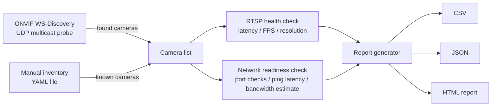

# Camera Network Discovery Toolkit

A command-line toolkit for running a technical site survey of IP cameras
before you design a video or AI architecture around them. Point it at a
customer network (or a plain list of known cameras) and it will find the
cameras, check whether their video streams actually work, check whether
the network ports and latency an architecture will depend on are usable,
and generate a report you can hand to whoever is designing or sizing the
system.

This is the kind of tool a solution engineer runs during (or right after)
a site walkthrough: before you can tell anyone how many recording servers,
how much storage, or how much network bandwidth a project needs, you need
real numbers from the actual site -- not just what the sales sheet or the
customer's spreadsheet says.

## Why this matters

Every video or AI-on-camera project starts with a site survey, and every
site survey runs into the same practical problems:

- The camera list the customer gave you is out of date, incomplete, or was
  written by someone who has since left the company.
- Some cameras that are supposedly "IP cameras" turn out to have flaky
  RTSP streams, wrong resolutions, or drop to a much lower frame rate than
  advertised once you actually connect to them.
- The network path to the cameras -- the ports, the latency, the available
  bandwidth -- is what actually constrains the architecture, and none of
  that is visible until someone measures it on site.
- Different customer environments have wildly different network policies:
  some let you run a discovery scan freely, some block multicast and any
  kind of scanning outright.

Doing this by hand with a stopwatch and a notepad does not scale past a
handful of cameras, and it does not produce anything you can leave behind
with the customer. This toolkit turns that survey into a repeatable,
scriptable process with a report at the end.

## How it fits together



Either path on the left (automatic discovery or a manual list) feeds the
same downstream checks, so the rest of the toolkit does not care how a
camera was found.

## Design decisions

**ONVIF vs. RTSP -- two different jobs.** ONVIF is a *device management and
discovery* protocol: it is how you find a camera on the network, ask it
what it supports, and configure things like its resolution or its users.
RTSP is the *media streaming* protocol: it is how you actually pull the
live video out of the camera once you know its address. A concrete
example: ONVIF WS-Discovery tells you "there is a camera at
`192.168.1.50`, and its device management service is at
`http://192.168.1.50/onvif/device_service`" -- but to actually watch its
video, you still need a separate RTSP URL such as
`rtsp://192.168.1.50:554/stream1`, usually obtained by calling an ONVIF
"GetStreamUri" operation or just knowing the vendor's convention. This
toolkit reflects that split: `discovery.py` only speaks the ONVIF
discovery half, and `rtsp_health.py` only speaks the RTSP media half.

**Why WS-Discovery/multicast instead of a full port scan.** A full network
scan (e.g. sweeping every host on a /24 for open port 80/554/8000) is
slower, noisier, and much more likely to trip a customer's intrusion
detection/prevention system than a single WS-Discovery probe. WS-Discovery
is also *purpose-built* for this: ONVIF devices are specifically listening
for it and will self-identify, including their service type, instead of
you having to guess "is this open port 80 a camera or a printer?" from a
banner grab. The tradeoff is that WS-Discovery only works when UDP
multicast is allowed on the segment, which is why this toolkit does not
rely on it as the only option (see the next point).

**Why manual inventory mode exists.** In practice, a large fraction of
customer networks either block multicast between VLANs, disable it on
camera switch ports for security reasons, or simply will not authorize an
unfamiliar laptop to run any kind of active discovery or scan on their
production network. Some customers already have a documented camera list
from their integrator or facilities team. For all of those situations,
`manual_inventory.py` lets you feed the toolkit a plain YAML file of
cameras and get exactly the same downstream health/readiness checks and
report as automatic discovery would produce. This is why manual inventory
is treated as the primary, most-tested code path in this repository --
it is the mode that actually works on every network, whereas discovery
only works when the network cooperates.

**Why these specific ports and checks.** Port 554 (RTSP) is the actual
video path -- if it is not reachable from wherever the recording/analytics
box will sit, nothing else matters. Ports 80/443 (HTTP/HTTPS) are the
camera's web/ONVIF management interface, which most architectures also
need for configuration, firmware updates, or event subscriptions. Port
8000 is included because a number of camera vendors expose a proprietary
HTTP API on that port for features ONVIF does not cover. Latency matters
separately from "is the port open": a port can be reachable but with
enough round-trip delay to cause visible lag in PTZ control or to blow a
budget for control-loop timing in an automated system. None of this
replaces a full network engineering review, but it catches the most common
"this won't work as designed" surprises before an architecture is
committed to paper.

## Setup

### Local (virtual environment)

```bash
python -m venv .venv
source .venv/bin/activate      # on Windows: .venv\Scripts\activate
pip install -r requirements.txt
pip install -e .                # optional: installs the `camtoolkit` console command
```

Run against the bundled example (no real camera or network needed -- the
example IPs are documentation-only placeholders and the RTSP/port checks
will simply report them as unreachable):

```bash
python -m camtoolkit survey --inventory examples/cameras.yaml --out report.html
```

Run against a real camera, with real credentials supplied in your own copy
of the inventory file (never commit real credentials):

```bash
cp examples/cameras.yaml my-site-cameras.yaml
# edit my-site-cameras.yaml with the real IP, rtsp_url, username, password
python -m camtoolkit survey --inventory my-site-cameras.yaml --out survey-report.html
```

Try ONVIF auto-discovery on a network that allows multicast:

```bash
python -m camtoolkit discover --subnet 192.168.1.0/24
```

### Docker

```bash
docker build -t camtoolkit .
docker run --rm camtoolkit --help

# Mount a local inventory file and write the report back to the host:
docker run --rm -v "$(pwd)/examples:/data" camtoolkit survey \
    --inventory /data/cameras.yaml --out /data/report.html
```

Note that ONVIF WS-Discovery needs UDP multicast, which does not cross a
default Docker bridge network the way it would on a laptop's own NIC.
Run with `--network host` (Linux only) if you need `discover` to work from
inside the container; `survey` (manual inventory) works fine either way.

## Project structure

```
camera-network-discovery-toolkit/
├── src/camtoolkit/
│   ├── __init__.py
│   ├── __main__.py          # `python -m camtoolkit`
│   ├── cli.py                # command-line entry point (discover / survey)
│   ├── discovery.py          # ONVIF WS-Discovery (UDP multicast probe + XML parsing)
│   ├── manual_inventory.py   # YAML camera list loading/validation
│   ├── rtsp_health.py        # OpenCV RTSP connect/latency/FPS/resolution check
│   ├── network_readiness.py  # TCP port checks, ping latency, bandwidth estimate
│   └── report.py             # aggregation + CSV/JSON/HTML export
├── templates/
│   └── report.html.j2        # Jinja2 HTML report template
├── examples/
│   └── cameras.yaml          # sample manual inventory (placeholder data only)
├── tests/
│   ├── test_discovery.py
│   ├── test_manual_inventory.py
│   ├── test_network_readiness.py
│   ├── test_report.py
│   └── test_rtsp_health.py
├── .github/workflows/ci.yml   # ruff + pytest on every push/PR
├── Dockerfile
├── requirements.txt
├── pyproject.toml
├── conftest.py
├── LICENSE
└── README.md
```

## Testing

Everything in the test suite runs without a real camera or real customer
network -- multicast/RTSP/ONVIF I/O is exercised only through pure
parsing functions and monkeypatched fakes, and TCP checks run against a
local loopback server started by the test itself.

```bash
pip install -r requirements.txt
pytest -v
```

Lint (the same check CI runs):

```bash
ruff check .
```

What each test file actually exercises:

- `test_discovery.py` -- feeds a canned WS-Discovery `ProbeMatches` XML
  string into `parse_probe_matches()`; no sockets involved.
- `test_manual_inventory.py` -- loads and validates `examples/cameras.yaml`
  plus a set of intentionally-broken YAML structures.
- `test_network_readiness.py` -- starts a real loopback TCP server with
  `socketserver` to test the open/closed port paths, and feeds canned
  `ping` command output (Windows- and Linux-style) into the pure parser.
- `test_report.py` -- builds an in-memory report from sample data and
  checks the CSV, JSON, and rendered HTML all contain the right fields.
- `test_rtsp_health.py` -- monkeypatches `cv2.VideoCapture` with fake
  "good", "unopenable", and "slow" stream objects to exercise the
  success/error/timeout paths.

## Limitations & production hardening notes

This toolkit is intentionally scoped for a single engineer's laptop during
a survey, not as a production monitoring system. Things you would want to
add before relying on it for anything beyond that:

- **Real ONVIF authentication.** `discovery.py` only implements the
  unauthenticated WS-Discovery probe. Actually calling into a camera's
  ONVIF device/media services (to read its configuration or pull a real
  `GetStreamUri`) requires WS-Security (username token, digest, and
  correct clock-skew handling), which is not implemented here.
- **Multi-VLAN / multi-subnet sites.** WS-Discovery multicast typically
  does not cross VLAN boundaries. A real deployment often needs either a
  multicast relay/helper configured on site, or running discovery from a
  host on each camera VLAN, or simply defaulting to manual inventory per
  segment.
- **Credential handling.** The example inventory format stores credentials
  in a plaintext YAML file, which is fine for a throwaway example but not
  for a real customer engagement. A production version should pull
  credentials from a secrets vault (HashiCorp Vault, a cloud secrets
  manager, or at minimum OS environment variables / a `.env` file that is
  never committed) instead of plaintext YAML.
- **Rate limiting.** `survey` currently checks cameras one after another
  without any throttling. On a customer network with an active IDS/IPS,
  a burst of TCP connection attempts to many hosts in a short time can
  look like scanning activity and get the source IP blocked. A production
  version should add configurable delays/jitter between hosts and a
  documented "go slow" mode for sensitive environments.
- **Bandwidth estimation is a placeholder.** `estimate_bandwidth_headroom()`
  is an explicit formula-based planning number, not a measured value. A
  real bandwidth measurement needs a proper tool (e.g. iperf3) run from
  both ends of the link, which most customers will not authorize during
  an initial survey anyway.
- **No retry/backoff.** Every check in this toolkit runs once. A hardened
  version would retry transient failures (a single dropped ping, a camera
  that took an extra second to answer) before reporting a problem.

## License

MIT. See [LICENSE](LICENSE).
